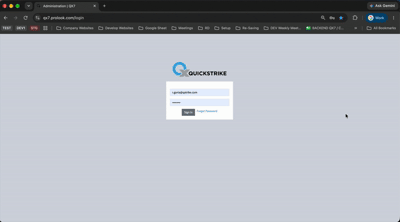
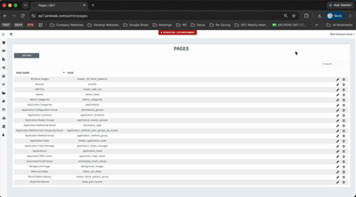
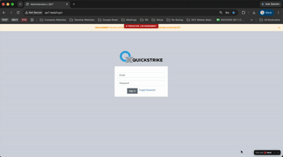
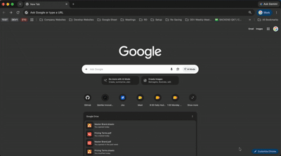

# Production Environment Warning

A lightweight Chrome extension that helps developers, software testers, and QA teams avoid accidentally working or testing on live production websites.

It displays a warning whenever you access a configured production environment, helping you recognize when you're working on a live system.

## Features

- Add, edit, and delete production websites.
- Support multiple production domains.
- Automatically detect child subdomains.
- Display a production warning modal.
- Five-second warning countdown.
- Persistent production environment badge.
- Remember warnings once per day.
- Reset warnings for all configured production websites.
- Save website configurations using Chrome local storage.

## Screenshots & Demonstrations

### Add Website

Add a production website directly from the extension popup.



### Edit Website

Update an existing production website.



### Delete Website

Remove a production website from your saved list.



## Installation

Choose either method to download and install the extension.

### Option 1: Download ZIP (Recommended)

No Git or coding knowledge required.

1. Open the [GitHub repository](https://github.com/ram-qstrike/production-warning-extension).
2. Click the green **Code** button.
3. Select **Download ZIP**.
4. Extract the downloaded ZIP file.
5. Open Google Chrome.
6. Navigate to `chrome://extensions`.
7. Enable **Developer mode**.
8. Click **Load unpacked**.
9. Select the extracted project folder containing `manifest.json`.

The extension is now installed!

#### Installation Video

Follow the demonstration below to install the extension using Download ZIP.



### Option 2: Git Clone

For developers who prefer using Git.

1. Open your terminal.
2. Run:

   ```bash
   git clone https://github.com/ram-qstrike/production-warning-extension.git
   ```

3. Open the project folder:

   ```bash
   cd production-warning-extension
   ```

4. Open Google Chrome and navigate to `chrome://extensions`.
5. Enable **Developer mode**.
6. Click **Load unpacked**.
7. Select the project folder.

The extension is now installed.

## How to Use

1. Click the **Production Environment Warning** extension icon.
2. Enter a production website domain.
3. Click **Add Website**.
4. Visit the configured production website.
5. The warning modal will appear automatically.

You can also edit or delete saved websites directly from the extension popup.

### Reset Warnings

Click **Reset Warning** to clear warning records for all saved production websites.

The five-second warning dialog will appear again the next time you visit each configured website.

## Supported Website Formats

You can enter either a hostname:

```text
example.com
```

Or a full URL:

```text
https://example.com/login
```

The extension automatically extracts and saves the hostname.

### Subdomain Support

Adding:

```text
example.com
```

Automatically matches:

```text
example.com
www.example.com
app.example.com
admin.example.com
```

You only need to add the main production domain once.

## Storage

The extension uses Chrome local storage:

```javascript
chrome.storage.local;
```

- Website configurations remain saved after closing or restarting Chrome.
- Warning records are stored locally.
- No account or external database is required.
- Websites remain saved until manually removed or extension data is cleared.

## Project Structure

```text
production-warning-extension/
├── manifest.json
├── content.js
├── popup.html
├── popup.css
├── popup.js
├── warning.css
├── icon.png
└── screenshots/
    ├── add.gif
    ├── edit.gif
    ├── delete.gif
    └── installation.gif
```

## Important

This extension is a visual safety reminder.

It does not:

- Block access to production websites.
- Prevent HTTP requests.
- Modify application behavior.
- Protect production data.
- Replace proper environment controls.

Its purpose is to make it immediately obvious when you're working on a live production environment.

**PRODUCTION — LIVE ENVIRONMENT.**

## License

This project is open source.
